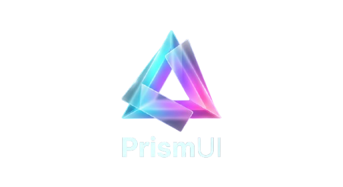

<div align="center">
  
</div>

# PrismUI 2.0

> **Status:** 2.0.0 rewrite in progress on `feat/glassmorphism-framework`. Not published to npm (`"private": true`).

**PrismUI** is an accessible, mobile-first **glassmorphism** web component framework built with
[Lit 3](https://lit.dev/), [Tailwind CSS 4](https://tailwindcss.com/), [Vite 8](https://vite.dev/) and
[Storybook 10](https://storybook.js.org/). Components are framework-agnostic custom elements with open shadow roots.

## Principles

- **Controlled components.** All meaningful state (`value`, `checked`, `open`, `page`, `sort`, …) comes from
  properties. User interaction emits *request* events (`prism-change`, `prism-open-request`, `prism-close-request`,
  `prism-sort-change`, `prism-filter-change`, `prism-page-change`, …); the component never changes those properties
  by itself. Form controls also re-emit native `input` / `change` from the host, so `v-model` and Angular
  `ngModel` / Reactive Forms work without adapters.
- **Tokens only.** Components consume `var(--prism-*)` design tokens. The dark theme is the `.dark` class (or
  `data-theme="dark"`) on any ancestor; there are no Tailwind `dark:` variants inside shadow DOM.
- **Accessible glass.** Text sits only on surfaces that are at least 85% opaque in light and 90% in dark. Controls
  have a dedicated border with at least 3:1 contrast. The focus indicator is a double ring (white inner ring, black
  outer outline). Opaque fallbacks apply without `backdrop-filter` or with reduced transparency.
- **Mobile first.** Touch targets are 44px by default; with a fine pointer, controls use 32/40/48px. Breakpoints
  are 640 / 768 / 1024 / 1280 / 1536px, `min-width` only.

## Usage (once components land)

```html
<link rel="stylesheet" href="@fabrizio.manna/prismui/tokens.css" />
<script type="module">
  import '@fabrizio.manna/prismui/button'; // registers <prism-button>
</script>
<html class="dark">
  <!-- or data-theme="dark" -->
</html>
```

## Development

Requires Node.js 24+.

```bash
npm install
npx playwright install chromium   # browser tests
npm run storybook                 # http://localhost:6006
npm run lint && npm run typecheck && npm run build && npm test
```

| Script                    | What it does                                                                       |
| ------------------------- | ---------------------------------------------------------------------------------- |
| `npm run lint`            | ESLint (TypeScript, Lit, WC, lit-a11y), CSS token guard, Prettier check            |
| `npm run typecheck`       | TypeScript 7 (`tsc`) type check of sources, tests and configs                      |
| `npm run build`           | Vite library build (ESM, one entry per component), `.d.ts`, Custom Elements Manifest |
| `npm test`                | Vitest: `unit` (Node), `browser` (Playwright Chromium), `storybook` (stories + axe) |
| `npm run storybook`       | Storybook dev server                                                               |
| `npm run build-storybook` | Static Storybook in `storybook-static/`                                            |

See [CONTRIBUTING.md](./CONTRIBUTING.md) for the folder layout, where tests and docs go, and the commit rules.

## License

ISC
